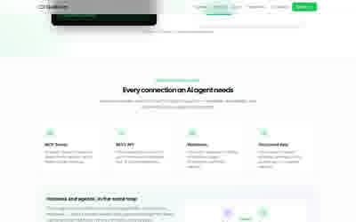

# GudForm

Open-source conversational form builder (Typeform alternative) built with Next.js, Prisma, and Postgres.

Website: [gudform.com](https://gudform.com) · OSS repo: [gudlab/gudform-core](https://github.com/gudlab/gudform-core)

If this is useful, **[star the public repo](https://github.com/gudlab/gudform-core)** — that's the open-source edition. Issues and OSS PRs belong there, not on the private SaaS copy.

<p align="center">
  <a href="https://www.gudform.com">
    
  </a>
</p>

<p align="center">
  <a href="https://www.gudform.com">
    
  </a>
</p>

<p align="center">
  <a href="https://www.gudform.com">Watch the full reel on gudform.com</a>
</p>

## Born West changes

`bw-main` is Born West's fork of GudForm. It branches from upstream at [`a44ca31`](https://github.com/bornwest/gudform-core/commit/a44ca31) ("Add product stills to the README"). Everything below was added on top of that.

### Teams, collections and ownership

- **Collections shared with teams** ([#5](https://github.com/bornwest/gudform-core/pull/5)): forms reach a team through the collections assigned to it. The dashboard has a "Shared with me" section for forms from your teams. The access rules live in `lib/form-access.ts`.
- **Owner-only settings** ([#5](https://github.com/bornwest/gudform-core/pull/5)): team members can edit shared forms, but only the owner can change the redirect URL, notifications, webhooks, auto-responder and payments.
- **Admins can file forms into shared collections** ([#7](https://github.com/bornwest/gudform-core/pull/7)): team owners and admins can create forms in, and move forms into, collections shared with their team. The same applies through the REST API and MCP.
- **Shared collections in the Collections tab** ([#8](https://github.com/bornwest/gudform-core/pull/8)): collections shared with your teams now show up alongside your own.
- **Team admins as form co-owners** ([#11](https://github.com/bornwest/gudform-core/pull/11)): owners and admins of a team a form is shared with get the same rights as the form's creator, including owner-only settings, moving forms, and the API and MCP. Only the creator can delete a form. See `isFormOwner` in `lib/form-ownership.ts`.

### Form builder and renderer

- **Welcome screen image** ([#9](https://github.com/bornwest/gudform-core/pull/9)): welcome screens can show an image on the left or right, set by URL or upload. Uploads for welcome images and choice images share one helper, `lib/upload-client.ts`.
- **Default welcome image** ([#10](https://github.com/bornwest/gudform-core/pull/10)): welcome screens without an image use `public/_static/images/welcome-default.png`.
- **No GudForm branding** ([#12](https://github.com/bornwest/gudform-core/pull/12)): removed the "Create your own form" link from thank-you screens, along with the `removeBranding` setting. The migration `20261118000000_remove_form_branding` drops the `removeBranding` column.
- **Color fields open the picker** ([#13](https://github.com/bornwest/gudform-core/pull/13)): the hex field next to the title and body color swatches is read-only, and clicking it opens the color picker.
- **Custom form URLs** ([#14](https://github.com/bornwest/gudform-core/pull/14)): owners and admins can set the slug in `/f/<slug>` from the builder's Settings sidebar, e.g. `/f/join-born-west-ios`. Slugs use lowercase letters, numbers and hyphens, 3–60 characters, and must be unique. Changing a slug breaks old links.
- **Closing forms**: a published form can be closed and reopened from the builder header. It also closes automatically after a close date and time, or once it reaches a response limit; both are set in the Closing section of the Settings sidebar. Visitors to a closed form see a "closed" page instead of "not found". Owners and admins can write their own message for that page; blank lines start paragraphs and `**bold**` / `*italics*` work. Closed forms keep unpublished edits as drafts, the same as published forms. The migration `20261120000000_add_form_closed_message` adds the `closedMessage` column.
- **Redirect after submission**: the "After submission" section of the Settings sidebar chooses between showing the success (thank-you) page and redirecting to a URL. Redirecting shows the thank-you screen first, then goes to the URL a few seconds later. URLs must be `http` or `https` and not point to a private address; `https://` is added if left off, and the server checks them when they're saved from the builder. Only owners and admins can change this. Before this, the redirect URL could only be set through the REST API.
- **Pasted NUL characters**: the server strips NUL characters (`\u0000`) from answers before saving them, so pasted text with NULs (e.g. copied from a PDF or binary file) no longer makes a submission fail with a 500. This covers submissions, drafts, paid forms, the REST API and MCP. See `stripNulFromAnswers` in `lib/form-response.ts`.

### Responses

- **Partial responses in the list**: a form's responses page and CSV export now include partial responses: answers saved as someone fills in a form they haven't submitted. They're marked "Partial". They still don't count towards a form's response limit. Upstream hid them, though the response count on the same page included them.
- **Collect IP addresses**: a per-form switch in the Privacy section of the builder's Settings sidebar, off by default. Only owners and admins can change it; it can also be set as `collectIpAddress` through the REST API. When it's on, responses and partial responses store the submitter's IP address, which appears in the response details and in an "IP Address" column of the CSV export. The server reads the IP from the first `x-forwarded-for` entry (or `x-real-ip`), so it's only reliable behind a proxy that sets those headers; any IP the browser sends is ignored. Responses created through the REST API or MCP with an API key don't store an IP. Form views still record an IP whatever the setting. The migration `20261124000000_add_form_collect_ip_address` adds the `collectIpAddress` column; see `lib/request-ip.ts`.

### Tracking

- **Google Tag Manager**: admins set one GTM container ID for the whole site under Site settings (`/admin/settings`). Every published form loads it with `GoogleTagManager` from `@next/third-parties`; previews don't. Forms push `form_view`, `form_start`, `form_question_submit` and `form_submit` to the data layer. Each event has `form_id` and `form_title`, and question events also have `question_id`, `question_number`, `question_type` and `question_title`. Answers are never sent. On classic (one-page) forms a question counts as submitted the first time it's answered. GA4 and any other tags are set up in Tag Manager, triggered by these events. There's no cookie-consent prompt for GTM. The migration `20261123000000_add_site_settings` adds the `site_settings` table; see `lib/gtm.ts`, `lib/gtm-events.ts` and `lib/site-settings.ts`.

### Storage

- **AWS S3 uploads** ([#6](https://github.com/bornwest/gudform-core/pull/6)): when all four of `S3_REGION`, `S3_ACCESS_KEY_ID`, `S3_SECRET_ACCESS_KEY` and `S3_BUCKET_NAME` are set, uploads go to S3 and the other storage settings are ignored for new files. `S3_PUBLIC_URL` and `S3_KEY_PREFIX` are optional; see `.env.example`. Uploaded files no longer expire, and the cleanup cron job (`/api/cron/cleanup-files`) was removed.

### Admin and navigation

These were committed straight to `bw-main`, not through PRs.

- **Admin users page**: shows each user's role and drops the plan and billing-period columns and the "Gift" plan button.
- **Sidebar**: "Users" moved into the main options. Admin Panel, Review Templates, Templates, Storage and Homepage are hidden outside the hosted SaaS edition.

### Deployment

- **Deploy on push** (committed straight to `bw-main`): pushing to `bw-main` runs `.github/workflows/deploy.yml`, which connects to the server over SSH and runs its `deploy` script. Settings: `HOST`, `USERNAME` and `PORT` as repository variables, `SSH_KEY` as a secret.

## Hosted vs self-host

| | Hosted SaaS | OSS / self-host |
|---|---|---|
| Builder, renderer, responses, teams | Yes | Yes (unlocked) |
| Unlimited forms and submissions | Yes (Free) | Yes |
| API + webhooks | Plan-gated | Unlocked |
| Billing, Stripe payments, integrations marketplace | Yes | Not in the public tree |

Self-host is **core only**. There is no env flag that turns a clone into GudForm Cloud. Details: [docs/oss-edition.md](docs/oss-edition.md) · [Self-hosting](docs/self-hosting.md)

## Quick start with Docker

```bash
git clone https://github.com/gudlab/gudform-core.git
cd gudform-core
docker compose up --build
```

Open [http://localhost:3080](http://localhost:3080), register with email and password, and create a form.

Health check: `GET /api/health`

## Local development without Docker

```bash
git clone https://github.com/gudlab/gudform-core.git
cd gudform-core
pnpm install
cp .env.example .env.local
pnpm db:push
pnpm dev
```

Minimum: `NEXT_PUBLIC_APP_URL`, `AUTH_SECRET`, `DATABASE_URL`. Google, Resend, and R2 are optional.

## Scripts

- `pnpm dev` — development server
- `pnpm build` / `pnpm start` — production
- `pnpm lint` — ESLint
- `pnpm test` — Vitest
- `pnpm db:push` — push Prisma schema

## API and SDK

- REST API: `/api/v1`
- MCP: `POST /api/mcp` — docs at `/docs/mcp` (same page in this repo and on [gudform.com/docs/mcp](https://gudform.com/docs/mcp))
- TypeScript SDK: `npm install @gudlab/gudform` (source: `sdk/`)
- Python SDK: `pip install gudform` (source: `sdk/python/`)
- Docs: `/docs`, `/docs/api`, `/docs/mcp`, `/docs/webhooks`
- Agent index: `/llms.txt` · OpenAPI: `/openapi.yaml`

## Contributing

See [CONTRIBUTING.md](CONTRIBUTING.md). Security reports: [SECURITY.md](SECURITY.md).

## Also from GudLab

Need scheduling next? Pair GudForm with [GudCal](https://www.gudcal.com) — open-source, agent-first booking (MCP + REST), self-hostable: [github.com/gudlab/gudcal-core](https://github.com/gudlab/gudcal-core)

## License

MIT — see [LICENSE.md](LICENSE.md).
